# 🏥 Awesome Clinic: Patient Visit Analysis

**What two months of visit records reveal about how a clinic really runs, and what management should do about it.**

   

> **Note:** the dataset is **simulated**. The methods and the way of reasoning carry over to real clinic data, but the specific numbers describe a fictional clinic.

---

## 📖 Contents

1. [The problem](#-the-problem)
2. [A day at Awesome Clinic](#-a-day-at-awesome-clinic)
3. [The six questions, answered](#-the-six-questions-answered)
4. [Five recommendations](#-five-recommendations)
5. [Where to start](#-where-to-start)
6. [Limitations](#%EF%B8%8F-limitations)
7. [How the analysis was done](#-how-the-analysis-was-done)
8. [Run it yourself](#%EF%B8%8F-run-it-yourself)

---

## 🎯 The problem

Awesome Clinic is a multi-department outpatient clinic with **35 doctors across 7 departments**: Cardiology, Orthopedics, Neurology, General Physician, Oncology, Psychiatry and Internal Medicine. Between **1 December 2025 and 31 January 2026** it recorded **4,207 patient visits**.

Management had the records but no clear picture. They didn't know:

- which departments and doctors carry the heaviest load
- who their patients are
- how long patients stay
- what drives the need for follow-ups

**Staffing, scheduling and follow-up planning were based on guesswork.** This project replaces the guesswork with evidence.

---

## ☀️ A day at Awesome Clinic

Before the charts, here is what the data looks like as **one typical day**: two months of totals divided by the 62 days covered.

> The doors open and, over the day, about **68 patients** arrive.
>
> **58 of them simply walk in.** Only about **10 were sent by doctors in other towns**, from places like Hamilton, Masterton or Napier. **Around 40 are 45 or older.**
>
> About **13 head to Neurology** and **13 to General Physician**, the two busiest departments. But inside Neurology the work isn't shared. Over the two months, one neurologist saw **231 patients**, close to 4 a day, while a colleague in the same department saw **23**, about one every three days.
>
> By evening, **46 patients have gone home**. The other **22 stay at least one night**, in every department about one in three. Before leaving, **17 are told they need a follow-up.**
>
> Then the holidays come. On **Christmas Day, 86 patients** arrive. Over 28–30 December, **85, 84 and 79** arrive. On the night of **29 December, 45 beds are occupied**, about 75% more than a normal night.

**That's the clinic in one sentence:** *steady and predictable in most ways, uneven in how doctors share the work, and under the most pressure exactly when staff most want time off.*

---

## 🔍 The six questions, answered

### 1. Workload: who carries the load?

Neurology (784 visits) and General Physician (780) together handle **over a third of all visits**.

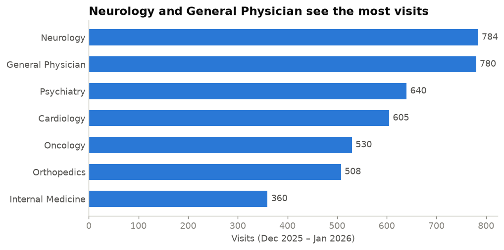

The department totals hide the real story. **Doctors range from 23 to 234 visits**, a **10× gap**. Only about half the doctors are close to the average of 120: **9 see more than 1.5× the average, and 10 see less than half of it.**

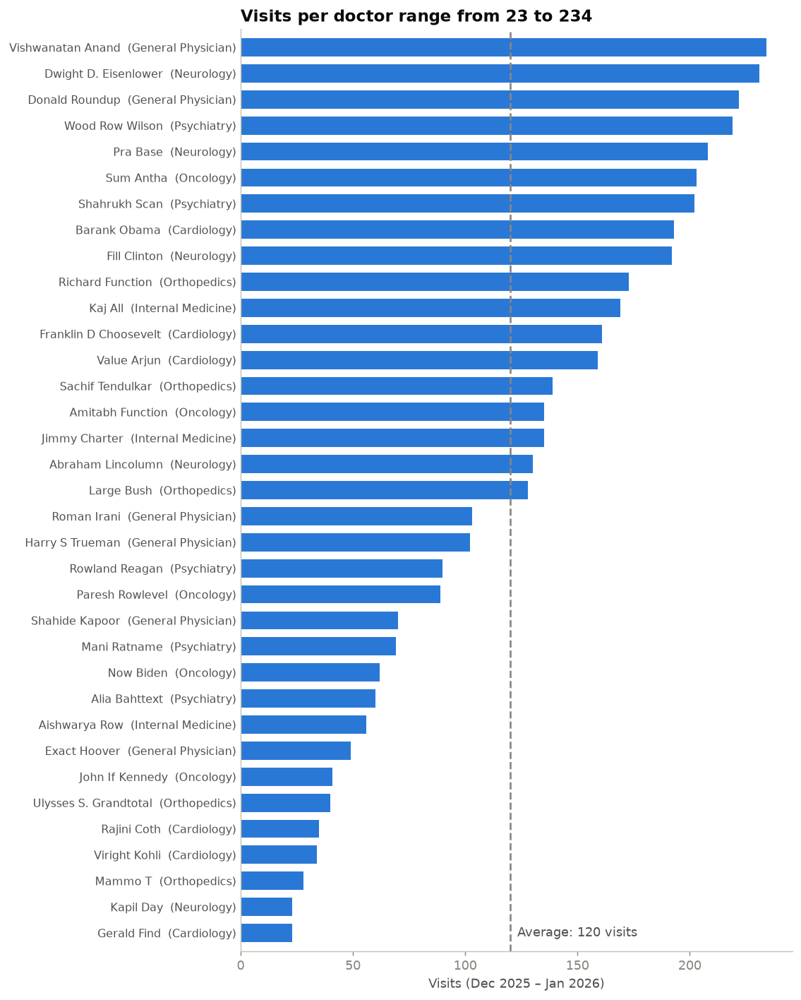

The gap isn't explained by one busy department and one quiet one. **It sits inside every department.** In each row below, the dots are doctors in the same department, often doing very different amounts of work.

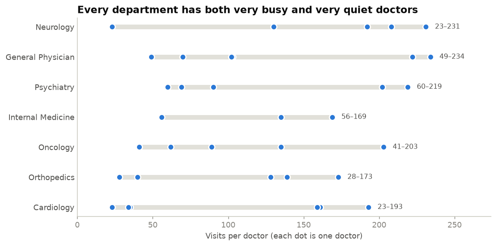

> **So what?** Some doctors are heading for burnout while colleagues down the corridor have spare time. Before hiring anyone, the clinic should check whether it is using the doctors it already has evenly.

---

### 2. Patient profile: who are the patients?

The median patient is **48 years old**. The largest group is **45–59 (38%)**, and **59% of patients are 45 or older**. Children make up just 4%. **55% of patients are men.**

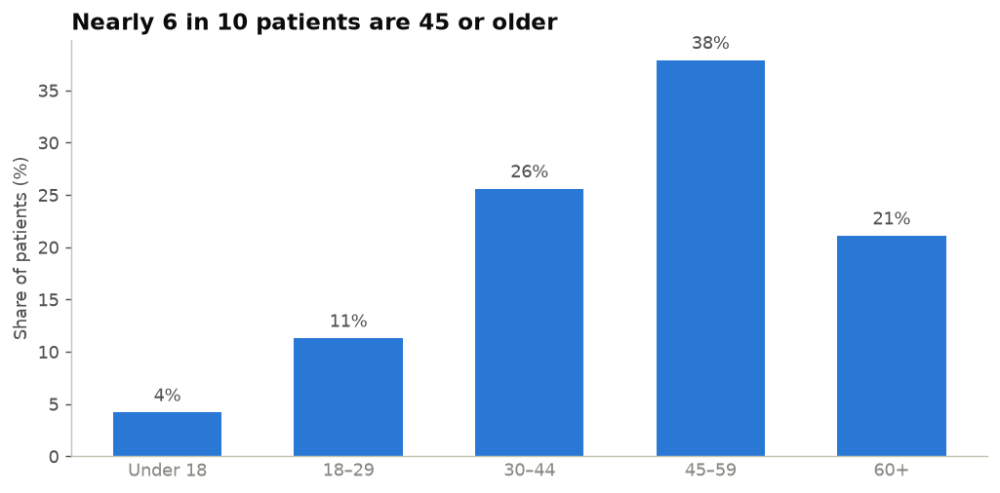

Every department sees **almost exactly the same age mix**. In real life, that would be surprising (children in Cardiology at the same rate as everywhere else?). Here it's a sign of the **simulated data**.

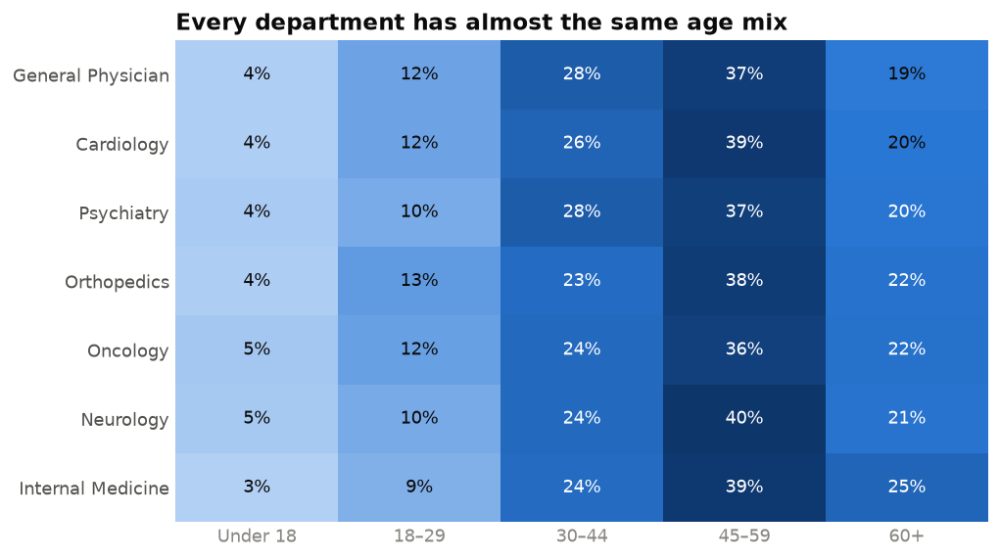

> **So what?** The patient experience should be designed around **patients aged 45+**, and **clinic-wide**, since no department has a different mix. It also means patient type **doesn't explain** the workload gaps above.

---

### 3. Length of stay: how long do patients stay?

**Two in three patients go home the same day.** About one in four stays one night, and only 5.5% stay two nights or more. Nobody stays longer than three.

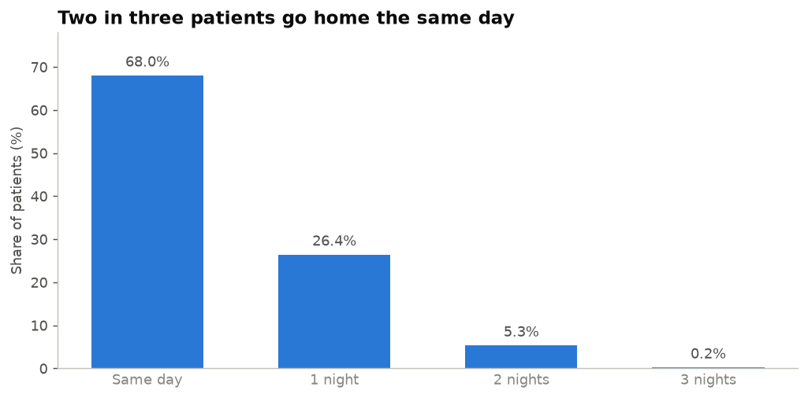

Departments barely differ: average stays range from 0.34 to 0.41 nights, and **about 1 in 3 patients stays overnight everywhere**. Internal Medicine has slightly more long stays (7.8% vs 5.5%).

> **So what?** Bed needs follow **patient volume**, not department type. The departments that see the most patients use the most beds. General Physician (300 bed-nights) and Neurology (286) lead.

---

### 4. Follow-ups: who needs to come back?

**About 1 visit in 4 (25.6%) needs a follow-up**, which is 1,076 over the two months.

Group differences in follow-up rates can easily be chance, so each rate is shown with a **95% range** (gray bar). If a range crosses the clinic average (dashed line), that group isn't clearly different. **Every department's range crosses it.**

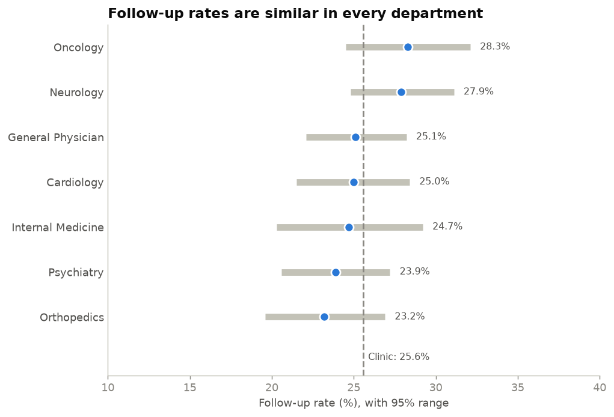

Two small gaps did hold up under testing:
- Patients who **stay overnight** need follow-ups slightly more often (**28% vs 24.5%**).
- **Men** need follow-ups slightly more often than women (27% vs 24%).

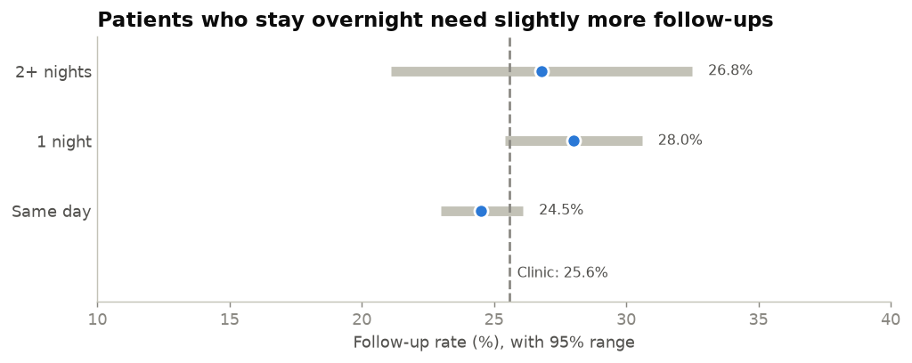

> **So what?** Follow-up demand is **steady and predictable**: plan about **one follow-up slot for every four visits**. Neurology (≈3.5 a day) and General Physician (≈3.2 a day) need the most slots.

---

### 5. Timing: when is the clinic busiest?

The clinic is busy **every single day**, averaging **68 visits** and ranging from 50 to 86. **The holidays didn't bring a quiet spell.** The holiday period (24 Dec – 2 Jan) averaged **73 a day** against 67 on other days.

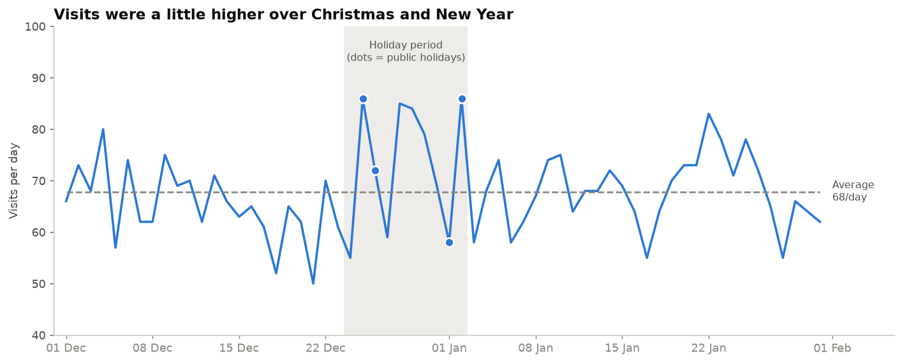

There's **no clear busiest day of the week**, and **weekends are as busy as weekdays.** The chart uses the *average per day*, because the two months contain only 8 Sundays against 9 of every other day.

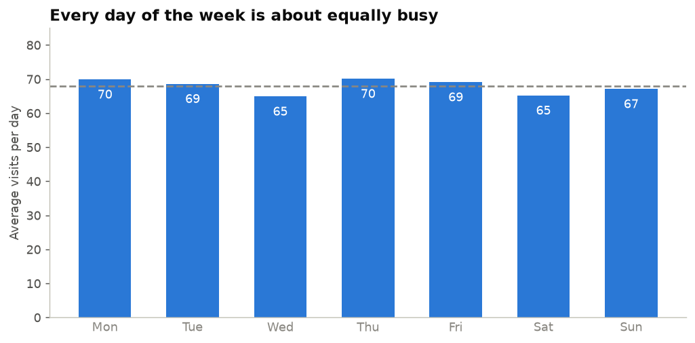

The rise in daily *arrivals* over the holidays could be chance (its 95% range crosses zero). **Bed use**, though, shows the holiday pressure clearly. Several busy days in a row stacked up overnight stays, and occupied beds hit **45 on the night of 29 December**, against **26 on a typical night**.

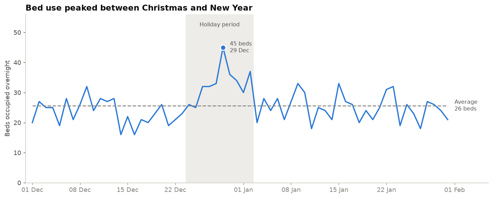

> **So what?** Staff every day of the week at a similar level, **weekends included**. **Don't cut back over Christmas and New Year.** That's when beds fill up most.

---

### 6. Referrals: where do referred patients come from?

**85% of patients walk in.** Only **615 (14.6%)** were referred, coming **evenly from 11 towns**. Even the biggest referrer, Hamilton, sends only about one patient a day.

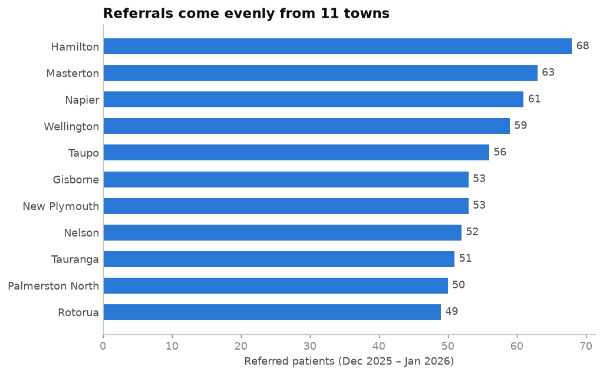

Every department receives a similar share of referred patients (13.5–16.6%). Referred patients are **just like walk-ins** in age, length of stay and follow-up rate.

> **So what?** The clinic's demand depends almost entirely on walk-ins. Referrals are a **small, steady and under-used** channel that could be grown, but only once there is capacity to absorb it.

---

## 💡 Five recommendations

Each recommendation includes a **scenario** showing the problem, and **when it applies** and when it doesn't, so it isn't applied blindly.

### 1️⃣ Share the workload more evenly within each department

> **Scenario:** *It's Monday morning in Neurology. Six patients are waiting, and four are lined up for the doctor who has averaged nearly 4 patients a day for two months. Down the corridor, a colleague in the same department has seen 23 patients in 62 days. Patients wait longer than they need to, one doctor heads for burnout, and paid time goes unused.*

| | |
|---|---|
| ✅ **Applies when** | the low-volume doctors are full-time and can treat the same patients |
| ❌ **Doesn't apply when** | a doctor is part-time, sub-specialised, or has teaching, research or management duties |
| 🛠️ **What to do** | Get doctor rosters first and measure *visits per session*. Then start a **shared walk-in queue** in Neurology and General Physician, where a walk-in goes to the next available doctor |
| 📏 **Success looks like** | the busiest-to-quietest ratio for full-time doctors falls from 10× to **under 2×** |

### 2️⃣ Plan beds and follow-ups with two rules of thumb

> **Scenario:** *Cardiology is adding a doctor expected to bring 10 more patients a week. "How many more beds and follow-up slots?" With the rules of thumb (**1 in 3 stays overnight, 1 in 4 needs a follow-up**) the answer takes seconds: ~3 more overnight stays and 2–3 more follow-ups a week.*

| | |
|---|---|
| ✅ **Applies when** | patient numbers change but the kind of care stays the same |
| ❌ **Doesn't apply when** | a new type of service starts (e.g. day surgery), which has its own pattern |
| 🛠️ **What to do** | Use the notebook's **planning table**. **Plan beds for the peak (45), not the average (26).** Book the follow-up before the patient leaves |
| 📏 **Success looks like** | no nights where occupied beds exceed staffed beds, and follow-ups available within the target time |

### 3️⃣ Staff evenly through the week, and don't cut back over the holidays ⏰ *urgent*

> **Scenario:** *It's 28 December. Half the team is on leave because "it'll be quiet over the holidays." 85 patients arrive that day and 84 the next. By the night of the 29th, 45 beds are full, nearly twice a normal night.*

| | |
|---|---|
| ✅ **Applies** | **now**: the 2026–27 holiday roster is being set in the coming weeks |
| ⚠️ **Caution** | only one holiday season of data, so the safe message is *"don't plan for a drop"* rather than *"plan for a surge"* |
| 🛠️ **What to do** | Roster weekends like weekdays. Keep **at least normal staffing for 24 Dec – 2 Jan**, with on-call cover for 27–31 Dec. Spread leave into November and February |
| 📏 **Success looks like** | no bed shortfalls over the 2026–27 holidays, and holiday waiting times similar to the rest of the year |

### 4️⃣ Shape the patient experience around patients aged 45+

> **Scenario:** *A 61-year-old stays overnight and is told to come back in two weeks, with no written note and no reminder. Two weeks later they've forgotten. Multiply that by the 40 patients aged 45+ who arrive every day.*

| | |
|---|---|
| ✅ **Applies to** | clinic-wide choices: waiting areas, signage, reminders, health information |
| ❌ **Doesn't call for** | department-specific changes, because every department has the same patient mix |
| 🛠️ **What to do** | Give a written follow-up appointment, then send a text or phone reminder. Make waiting areas and signage age-friendly. Target health information at ages 45–64 |
| 📏 **Success looks like** | higher follow-up attendance (needs a new "attended" field) |

### 5️⃣ Build referral links, once capacity is freed

> **Scenario:** *A GP in Napier needs a specialist for a patient. They send roughly one patient a day to Awesome Clinic, and no one at the clinic has ever called to say thanks or explain how to refer. Meanwhile, the clinic has doctors with empty appointment slots.*

| | |
|---|---|
| ✅ **Applies when** | Recommendation 1 has freed up capacity |
| ❌ **Doesn't apply while** | departments are stretched, because more referrals would lengthen the busiest doctors' queues |
| 🛠️ **What to do** | Thank the top referring towns, create one simple referral route per department, and send referrals to doctors with spare capacity |
| 📏 **Success looks like** | referrals rise from 15% toward a target such as 20%, spread evenly across doctors |

---

## 🗺️ Where to start

The recommendations depend on each other, so **order matters**:

| When | Action |
|---|---|
| **Now** | **3:** Set the holiday roster at full strength. **1:** Collect doctor rosters |
| **Next 3 months** | **1:** Rebalance workload (Neurology and GP first). **2:** Adopt the planning table |
| **3–6 months** | **4:** Follow-up reminders and patient experience |
| **6–12 months** | **5:** Referral links, once capacity exists |

> **The thread that ties it together:** the clinic doesn't obviously need *more* doctors or beds. It needs to **use the doctors it has more evenly**, **plan for the busy nights rather than the average ones**, and **stop assuming the holidays are quiet**.

---

## ⚠️ Limitations

- **Simulated data.** Patterns like identical patient mixes across departments are likely features of how the data was generated.
- **Two months only**, so there is only one holiday season to learn from.
- **No rosters or hours**, so overloaded doctors can't be separated from part-time ones.
- **No diagnosis, cost or outcome data**, so this describes *usage*, not *quality of care*.
- **Dates without times**, so peak *hours* can't be seen.
- **The follow-up flag shows a follow-up was needed**, not whether it happened.

**Data that would make the next round much stronger:** doctor rosters, arrival times, whether follow-ups were attended, reasons for visit or referral, and 12+ months of history.

---

## 🔬 How the analysis was done

The notebook works through the problem in **8 steps**, each split into small, explained cells:

| Step | What happens |
|---|---|
| **1. Clean the data** | Tidy column names and doctor names, restore post-code leading zeros, label blanks (`Unknown` gender, `Walk-in` referral), join the two sheets, add `age`, `length_of_stay` and `referred`, and run sanity checks |
| **2–7. One question each** | Tables, charts and written findings for each key question |
| **8. Bring it together** | The typical-day story, nightly bed occupancy, a planning table, and the recommendations |

**A note on rigour:** many differences in this data are only 2–3 percentage points. Rather than reporting every gap as a finding, the analysis gives each rate a **95% range** and directly tests the biggest gaps, and it says plainly when a difference **"could be chance."**

### The data

`clinic_visits_2026.xlsx` has two sheets:

| Sheet | Rows | Columns |
|---|---|---|
| `Patients` | 4,207 (one per visit) | Patient ID, DOB, Gender, Post Code, Referred by, In Date, Out Date, Doctor ID, Follow-up required? |
| `Doctors` | 35 | Doctor, Doctor ID, Department |

### Project structure

```
clinic-analysis/
├── clinic_analysis.ipynb     # the full analysis
├── clinic_visits_2026.xlsx   # the data
├── images/                   # charts used in this README
├── requirements.txt          # Python packages
└── README.md
```

---

## ▶️ Run it yourself

```bash
git clone <this-repo-url>
cd clinic-analysis
python -m venv .venv
.venv\Scripts\activate          # Windows  (macOS/Linux: source .venv/bin/activate)
pip install -r requirements.txt
```

Then open `clinic_analysis.ipynb` in VS Code or Jupyter and choose **Run All**.
